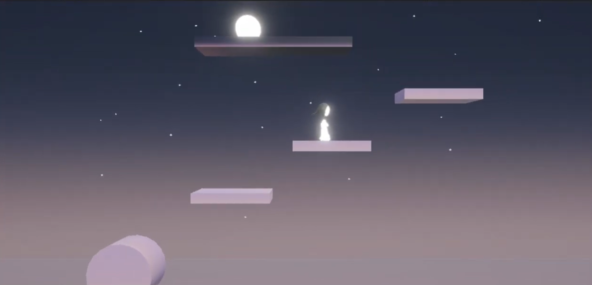

This game was created collaboratively in a team of myself and two other designers using Blender, Unity, and GitHub. My responsibilities were creating the physics-based platforms and level design. This was created for a video game design class.

This project challenged my ability to work as a team to make creative decisions. All the people on my team were creative, and all had their own ideas on what the final product should be. I took responsibility to get us all on the same page of what our goals were, and to manage the team's expectations of what we could realistically accomplish in the given time frame. This required making compromises to ensure that all team members felt that their ideas were heard and implemented, while also reigning in the project to a reasonable scope.

View a video of the gameplay <a href="https://drive.google.com/file/d/1H_cKIJnn8E7CTGGMO9JLJmHHa3HIRO2D/view?usp=sharing">here.</a>

Or, play the game for yourself at <a href="https://alyoola.itch.io/climb-and-punishment">https://alyoola.itch.io/climb-and-punishment</a>!
