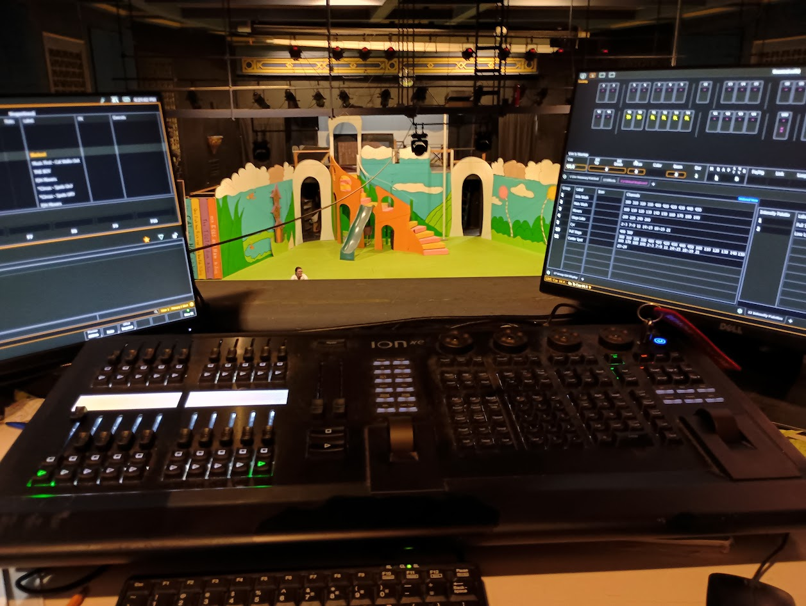
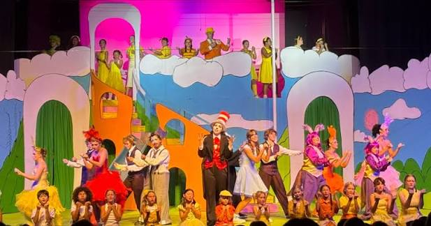
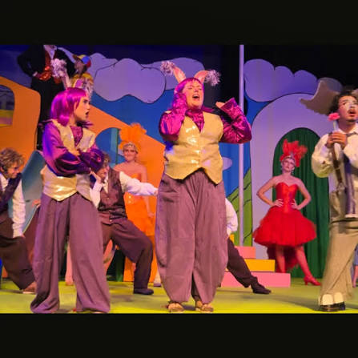
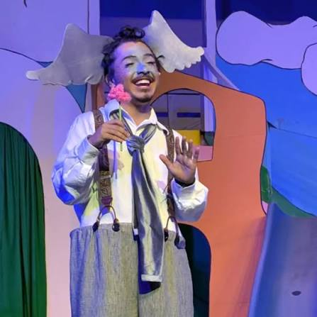

I volunteered as the lighting operator for my local community theater's production of Seussical. I was required to operate the lighting during shows, train and manage the volunteer spot operators. I also volunteered for other miscellaneous tasks in preparing for the show and breaking down afterwards. 

This job challenged my ability to improvise on the fly, when changes were made or technical difficulties were experienced mid-show. It was me and the rest of the tech team's responsibility to make sure lighting, sound, and effects in the show went off without a hitch, and that sometimes meant making split-second decisions about the best course of action as the show goes on.

