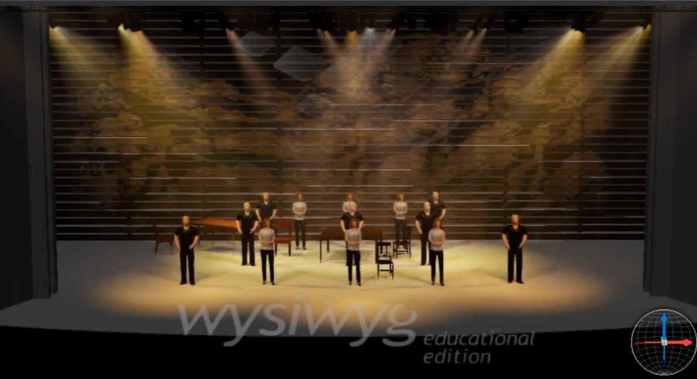

This is a simulation of a lighting design for Welcome to the Rock, the opening number of Come From Away. This project was done for an Intermediate Lighting Design class.

From this project, I learned the basics of lighting design for theater. I learned to consider all factions in my design, from the perspective of the audience, to the cloth color and type of the costumes, to where set pieces are, to the blocking of the actors. I had to weigh different decisions and make compromises to produce the best result I could.

View the video <a href="https://drive.google.com/file/d/1iA1PFoJLhv1fI0AazXG6ZPatKGCru4ZY/view?usp=sharing">here.</a>
